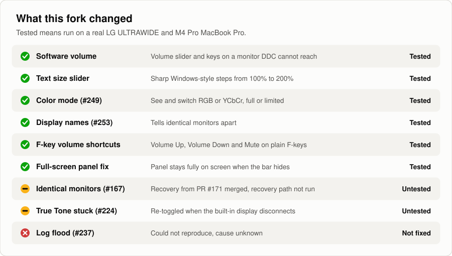
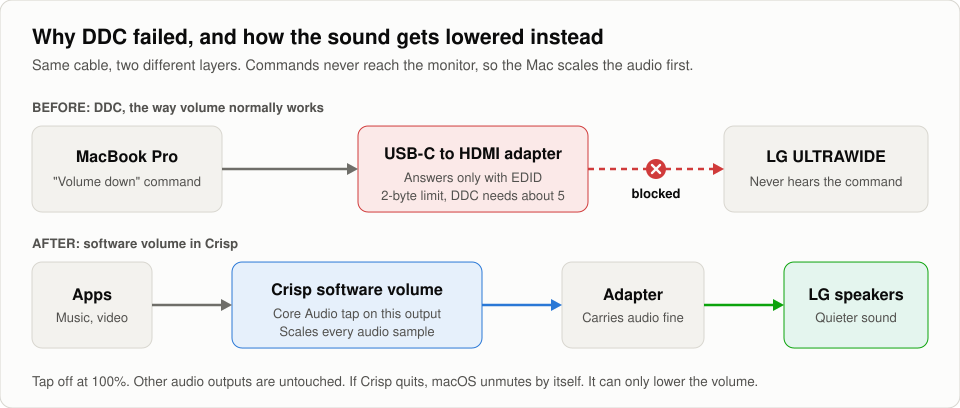
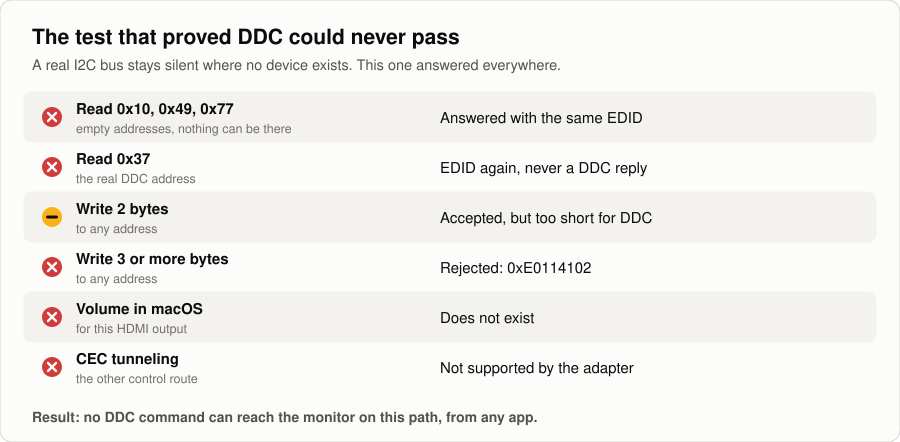
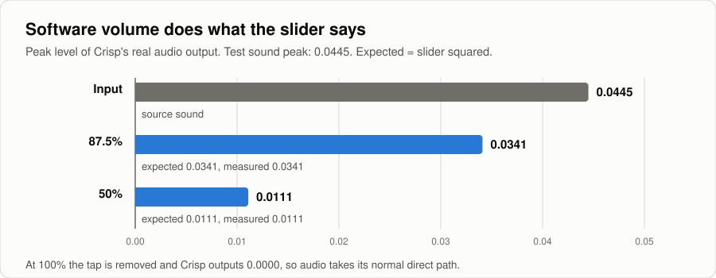

<div align="center">


# Crisp

**Every display control macOS hides, in one menu bar panel.**

Free, open-source external monitor control for macOS.<br>
Sharp HiDPI scaling, DDC brightness, presets and virtual displays.

[](https://github.com/didriksg/Crisp/releases/latest/download/Crisp.dmg)

[](https://github.com/didriksg/Crisp/releases)
[](#requirements)
[](LICENSE)

[Website](https://crispmac.app/) · [Crisp vs BetterDisplay & Lunar](https://crispmac.app/crisp-vs-betterdisplay.html) · [Fix a blurry external monitor](https://crispmac.app/fix-blurry-external-monitor-macos.html) · [中文](https://crispmac.app/zh.html)

</div>

---

Crisp is a lightweight, native menu bar app for controlling external monitors on macOS, and a free, open-source alternative to BetterDisplay and Lunar. It adds what macOS leaves out: sharp HiDPI scaling on any monitor (no more blurry or tiny text), real brightness and volume control over DDC, presets, display arrangement, and virtual displays. Every feature is free, with no Pro tier and no license key.

Available in English, 简体中文 and 繁體中文.

> **This is a personal fork of [didriksg/Crisp](https://github.com/didriksg/Crisp).** It adds software volume, a text size slider, color mode switching, display names and F-key volume shortcuts, and fixes several open issues. See [What this fork adds](#what-this-fork-adds) and [the LG monitor story](#the-lg-monitor-story). The download links and the Homebrew cask below install the original app, not this fork; to get these changes, [build from source](#building).

https://github.com/user-attachments/assets/90a62808-84d2-40d6-8563-0b282b9b4b6d

## Install

```sh
brew install --cask crisp
```

Or download [`Crisp.dmg`](https://github.com/didriksg/Crisp/releases/latest/download/Crisp.dmg) and drag Crisp to Applications. Every release is signed and notarized by Apple, so it opens with a normal double-click.

Installed from `didriksg/tap` earlier? `brew upgrade` moves you to the main cask by itself; `brew untap didriksg/tap` afterwards is optional cleanup.

## Features

- **Sharp, Retina-quality scaling on any display**: HiDPI resolutions that make external monitors crisp instead of blurry or tiny, set up automatically for 1440p and larger, always at the panel's full refresh rate (no more 1080p stuck at 50Hz on a 144Hz monitor)
- **Smooth scaling**: set how large everything looks in small steps, far beyond the few sizes macOS offers
- **Brightness everywhere**: the real backlight of external monitors over DDC, software dimming where that isn't supported and below the hardware minimum, and brightness keys that follow the pointer, all displays, or a chosen few, or shortcuts of your own
- **Extra Brightness**: push XDR MacBook panels and HDR monitors past 100% into their HDR headroom; one toggle per display, then the slider and keys reach further. It draws more power, and HDR video can look overblown while it's on
- **Volume**: monitor speaker volume over DDC, or software volume where the connection blocks DDC, with a slider per display, the volume keys mapped to the monitor when it's your audio output, and assignable shortcuts that can be plain F-keys
- **Presets**: save resolution, brightness, arrangement, image adjustment, HDR and which displays are on under a name and icon, and apply them with one click, from Shortcuts, or from crispctl
- **Shortcuts**: apply a preset, set brightness, HDR, Extra Brightness, image adjustment or a monitor's input, and disconnect or reconnect a display, as actions in the Shortcuts app, so an automation can switch your displays between a day and a night setup
- **Display arrangement**: drag-to-arrange canvas, main display switching, and a pointer that crosses edges where displays of different sizes don't line up
- **Disconnect displays**: turn physical displays off and back on from the menu or a switch on each display row, remembered across sleep and reboot, and keep the built-in off while you're docked (Apple Silicon)
- **Text size**: a slider that makes text and icons larger on an external display in Windows-style steps, 100% to 200%, staying sharp
- **Color mode**: see and switch an external display's signal, RGB or YCbCr, full or limited range, without an EDID override
- **Display names**: give a monitor your own name, which tells identical monitors apart
- **Input switching**: switch a monitor to another input over DDC, a second computer on HDMI for instance, and back from the menu
- **System toggles**: Dark Mode, Night Shift, and True Tone, one click from the menu bar
- **Color**: ICC profile switching, XDR reference presets, HDR on/off per display, and image adjustment (gamma, contrast, gain, invert colors)
- **Virtual displays**: create HiDPI virtual screens
- **Extras**: combined brightness slider, auto brightness following the built-in display, a toggle for macOS's own ambient auto-brightness, keep awake, notch hiding, launch at login

## What this fork adds

<picture>
  <source media="(prefers-color-scheme: dark)" srcset="docs/readme/fork-status-dark.svg">
  
</picture>

| Change | What you get |
| --- | --- |
| **Software volume** | A working volume slider and keys on a monitor that DDC can't reach and macOS gives no volume. It only touches audio going to that monitor |
| **Text size slider** | Windows-style 100% to 200% under each external display's sliders. Text and icons get larger and stay sharp, because only HiDPI modes are used |
| **Color mode** | See and switch the signal, RGB or YCbCr, full or limited range, from the panel or `crispctl`, with no EDID override. It lasts until the display reconnects |
| **Display names** | Name a monitor yourself, which tells identical monitors apart |
| **Volume shortcuts** | Volume Up, Volume Down and Mute in Settings > Keyboard Shortcuts, and an F-key can be used on its own |

### Fixes

<details>
<summary>Every fix, with links to the issues</summary>

| Issue | Status |
| --- | --- |
| [#253](https://github.com/didriksg/Crisp/issues/253) Wrong names on identical monitors | macOS assigns the (1) and (2), so displays can now be renamed |
| [#249](https://github.com/didriksg/Crisp/issues/249) Color mode info and selection | Added, see above |
| [#167](https://github.com/didriksg/Crisp/issues/167) Identical monitors look different | Merged the recovery from [#171](https://github.com/didriksg/Crisp/pull/171) by [@DEOWL-kan](https://github.com/DEOWL-kan). Its recovery path has not been run on this fork's test hardware |
| [#224](https://github.com/didriksg/Crisp/issues/224) True Tone stuck on an external | True Tone is re-toggled whenever the built-in display is disconnected. Not yet tested on hardware |
| Panel cut off in full screen | The panel stays below where the menu bar belongs, even while a full-screen app hides the bar |
| Software volume started near silent | A forced monitor's slider started at 0, so one press up landed at 6%. It now starts at 100 |
| [#237](https://github.com/didriksg/Crisp/issues/237) Log flood from AmbientDisplayAgent | **Not fixed.** It didn't reproduce here and the cause is unknown |

</details>

## The LG monitor story

My LG ULTRAWIDE (3440x1440) is connected to a MacBook Pro through a USB-C to HDMI adapter, and its speakers are my Mac's sound output. macOS greys out volume for that output, so the only way to turn it down was the monitor's own buttons. I wanted a slider and my keyboard's volume keys, the way BetterDisplay describes it.

Crisp showed no slider, so I turned on its Volume Control override. The slider appeared and did nothing. The log explained why: every volume change was failing, silently, with `write 0x62=20: failed all 3 attempts`.

<picture>
  <source media="(prefers-color-scheme: dark)" srcset="docs/readme/lg-audio-path-dark.svg">
  
</picture>

**Trying to make DDC work.** DDC is how a Mac sends a monitor commands over the video cable, and every write came back with error `0xE0114102`. Spacing the commands out, sending them twice, changing the sub-address and using the second macOS I2C API all failed the same way. Then came the test that settled it:

<picture>
  <source media="(prefers-color-scheme: dark)" srcset="docs/readme/lg-i2c-test-dark.svg">
  
</picture>

<details>
<summary>The same results as a table</summary>

| Test | Result |
| --- | --- |
| Read I2C addresses where nothing can exist (`0x10`, `0x49`, `0x77`) | Every one answered, with the same EDID |
| Read the real DDC address `0x37` | The same EDID, not a DDC reply |
| Write 2 bytes | Accepted, at any address |
| Write 3 or more bytes | Rejected, at any address |
| Audio device volume in macOS | Doesn't exist for this output |
| CEC tunneling | Not supported by the adapter |

</details>

A real I2C bus doesn't answer at empty addresses. Something on this path is imitating the bus, and it only serves the EDID. The shortest DDC request needs about 5 bytes in one transaction and only 2 get through, so no DDC message can reach the monitor. No app can get around that, including BetterDisplay, whose maintainer says it uses DDC for volume too. USB-C itself can carry DDC; it's this path that can't. The adapter reports USB ID `057E:2003`, and `057E` is Nintendo's vendor ID, though that alone doesn't say what the adapter really is.

**Going around it.** The monitor couldn't be told to lower its volume, so the Mac lowers the audio before sending it. Crisp now uses a Core Audio process tap on that one output, scales the samples, and plays them back. Other outputs are untouched, macOS unmutes by itself if Crisp ever dies, and at 100% the tap is removed, so the audio takes its normal direct path.

The level was measured on Crisp's real output stream, using a test sound that peaked at `0.0445`:

<picture>
  <source media="(prefers-color-scheme: dark)" srcset="docs/readme/lg-volume-levels-dark.svg">
  
</picture>

<details>
<summary>The same results as a table</summary>

| Slider | Expected | Measured |
| --- | --- | --- |
| 87.5% | `0.0341` | `0.0341` |
| 50% | `0.0111` | `0.0111` |
| 100% | Tap off, no output from Crisp | `0.0000` |

</details>

**Three more things went wrong along the way:**

- The fallback skipped my monitor at first, because the override I'd turned on made it look supported. A failed write now triggers it.
- The slider on a forced monitor started at 0, so the first press up made the sound nearly silent.
- A debug build had a broken code signature, so macOS ignored its permissions and the keys did nothing. A properly signed install fixed it.

**What it can't do.** Software volume only lowers sound, so set the monitor's own volume to the loudest you'll want. Hardware brightness doesn't work on this path either, so brightness is software dimming. Hardware control needs a connection that really passes DDC, such as a different adapter or a built-in HDMI port, which I haven't tested on this monitor.

**Bonus find.** Reading the display's state showed macOS was driving the LG with YCbCr limited range even though it ranks RGB full range higher. That's what led to the Color Mode control.

### F10, F11 and F12 for volume

These can be set in Settings > Keyboard Shortcuts. Two things to know:

- macOS keeps F11 for Show Desktop, so turn that off in System Settings > Keyboard > Keyboard Shortcuts > Mission Control.
- A MacBook's built-in keyboard sends media keys, not F-keys, so plain F10 to F12 there need Accessibility permission. Other apps stop receiving any F-key you bind.

## How does it compare?

BetterDisplay and Lunar are excellent, deeper tools. Crisp keeps the everyday essentials free: flexible HiDPI scaling, hardware brightness, presets, disconnecting displays, color adjustments, and auto-brightness sync. See the full side-by-side: [Crisp vs BetterDisplay, Lunar & MonitorControl](https://crispmac.app/crisp-vs-betterdisplay.html).

## Support

Crisp is and will stay completely free. Its main running cost is the $99/year Apple Developer Program, Apple's fee for signing and notarizing the app so it installs cleanly. If you've found Crisp useful, or it saved you a BetterDisplay or Lunar license, and you'd like to chip in toward keeping Crisp signed and notarized, there's:

- [GitHub Sponsors](https://github.com/sponsors/didriksg)
- [Ko-fi](https://ko-fi.com/didriksg)
- [爱发电 (Afdian)](https://ifdian.net/a/didriksg)

Completely optional, but you'll have my heartfelt thanks.

### Sponsors

Thank you to the people chipping in toward keeping Crisp signed and notarized:

- **Arnor Ingthorsson** ([@arnor-ingthorsson](https://github.com/arnor-ingthorsson))
- **Barry** ([@BarryBarrywu](https://github.com/BarryBarrywu))
- **[@kuldipmaharjan](https://github.com/kuldipmaharjan)**
- **Volodymyr Dombrovskyi** ([@rebelvg](https://github.com/rebelvg))

## Requirements

- macOS 14 (Sonoma) or later; on macOS 26 the panel uses the native Liquid Glass backdrop

## Permissions

- **Administrator password** (one time, per monitor): needed only when you turn on smooth scaling, which installs a display override file into `/Library/Displays/Contents/Resources/Overrides` that macOS protects. Regular HiDPI scaling and everything else are password-free.
- **Accessibility** (System Settings > Privacy & Security > Accessibility): needed only if you turn on Brightness Keys, which routes the keyboard brightness keys to other displays (follow the pointer, all connected, or a chosen subset). Without it, everything else still works; the keys just control the built-in display as usual.
- **System Audio Recording** (System Settings > Privacy & Security): asked for the first time software volume goes below 100%. It lets Crisp lower the sound going to that monitor. Nothing is recorded or saved.

## Languages

Crisp picks the first language in your Mac's preferred languages that it supports. To run Crisp in a different supported language than the rest of your Mac, choose it under System Settings > General > Language & Region > Applications.

## Managed Macs

To keep Keep Awake off on company Macs, push a configuration profile for the `com.crisp.app` domain with `crisp.disableKeepAwake` set to `true`. Crisp reads it at launch and leaves the row out of Tools. A managed value outranks the user's own preferences, so it cannot be switched back on with `defaults write`.

## Automation

Crisp ships with `crispctl`, a command line tool for the same controls: list displays, read and set brightness, switch Extra Brightness and HDR, change image adjustment, apply a preset, switch a monitor's input, and disconnect or reconnect a display. The Command Line Tool switch in Settings links it into `/usr/local/bin` (the Homebrew cask does this on install); it also lives inside the app at `Crisp.app/Contents/MacOS/crispctl`. Crisp must be running.

```sh
crispctl display list                  # JSON, with each display's id and uuid
crispctl brightness set <display> 40
crispctl display toggle <display>      # for a KVM desk or a button
crispctl preset apply Night
crispctl display scale set <display> 125  # text size
crispctl display color list <display>
crispctl display rename <display> "Desk LG"
```

The same controls are actions in the Shortcuts app: Apply Crisp Preset, Set and Get Display Brightness, Set Extra Brightness, Set Display HDR, Set Display Input, Disconnect and Reconnect Display, and Set and Reset Image Adjustment. A Time of Day automation that runs Apply Crisp Preset switches your displays between a day and a night setup.

`crispctl help` lists every command, and `--help` on any command gives its details. To let an AI agent drive it, `crispctl skill install claude` or `crispctl skill install codex` adds a skill for Claude Code or Codex; for another agent, `crispctl skill show` prints it. Run the install again after updating Crisp.

## Building

```sh
brew install xcodegen
xcodegen generate   # generates Crisp.xcodeproj from project.yml
open Crisp.xcodeproj
```

macOS permissions need a properly signed build. If Accessibility or System Audio Recording silently does nothing, check the signature with `codesign --verify --strict`. With an Apple Development certificate and Crisp already in Applications, `CRISP_SIGN_ID="Apple Development" ./dev.sh` builds, signs and installs it, and permissions survive rebuilds.

For a distributable DMG (plain swiftc, plus Xcode for the Shortcuts actions) and the fast edit-compile-run dev loop (Command Line Tools only), see [docs/BUILDING.md](docs/BUILDING.md).

## Contributing

Issues and pull requests are welcome. Found a bug, want a feature, or have a display Crisp doesn't handle well? [Open an issue](https://github.com/didriksg/Crisp/issues) or start a [discussion](https://github.com/didriksg/Crisp/discussions). PRs are just as welcome, whether it's a fix, a feature, or a new translation.

## Origin

Crisp began as a fork of [FreeDisplay](https://github.com/huberdf/FreeDisplay) and has since been substantially rewritten: a custom panel architecture, native controls throughout, a reworked brightness pipeline, and a full redesign. Thanks to FreeDisplay for the foundation and the spirit: free display management for everyone.

## License

[MIT](LICENSE). Portions derived from FreeDisplay remain available under its MIT terms, reproduced in [ACKNOWLEDGMENTS.md](ACKNOWLEDGMENTS.md).
